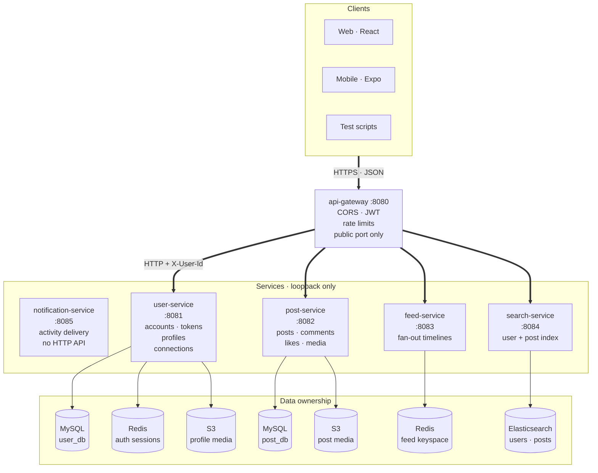
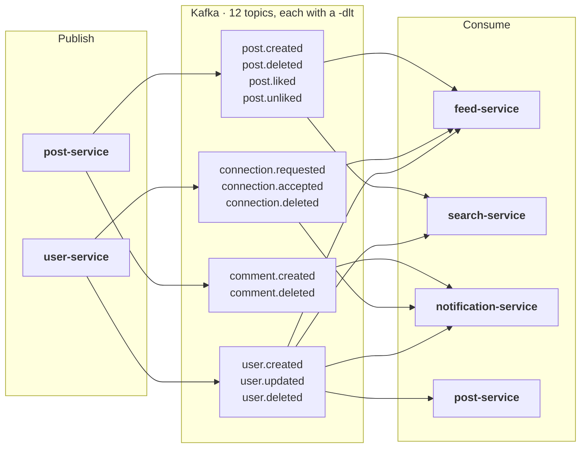

# LinkedIn Clone

A LinkedIn-style social platform built as six Spring Boot services that share nothing but events.
Profiles, connections, posts with media, a fan-out feed, and full-text search — each owned by the
service that owns its data.

The system is deliberately boring where it matters: one entry point, one identity token format, one
event contract, and no service reading another service's database.

---

## Architecture



**Only the gateway is exposed to clients.** It verifies the access token, imposes a rate limit, and
forwards an `X-User-Id` header that services trust. Services bind to loopback so that header cannot
be forged from outside.

### Services

| Service | Port | Owns | Store | Publishes | Consumes |
|---|---|---|---|---|---|
| [api-gateway](api-gateway/README.md) | 8080 | routing, authn, throttling, CORS | Redis (counters) | — | — |
| [user-service](user-service/README.md) | 8081 | accounts, tokens, profiles, connections | MySQL `user_db`, Redis, S3 | `user.*`, `connection.*` | — |
| [post-service](post-service/README.md) | 8082 | posts, comments, likes, media | MySQL `post_db`, S3 | `post.*`, `comment.*` | `user.deleted` |
| [feed-service](feed-service/README.md) | 8083 | per-user feed timelines | Redis | — | `post.*`, `connection.*`, `user.deleted` |
| [search-service](search-service/README.md) | 8084 | searchable user/post projections | Elasticsearch | — | `user.*`, `post.*` |
| [notification-service](notification-service/README.md) | 8085 | activity delivery | — (stateless) | — | `user.created`, `connection.*`, `post.liked`, `comment.created` |

### Rules the codebase follows

1. **One writer per fact.** A user's profile lives in `user_db`; its searchable copy is a
   projection in Elasticsearch that only `search-service` writes.
2. **Events are the only cross-service call.** No service makes an HTTP call to another service;
   everything asynchronous is a Kafka message.
3. **Ids are plain strings.** UUIDs generated by the owning service, so no service has to know how
   another mints them — or whether it still uses the same scheme.
4. **The JSON body is the contract.** Events carry no `__TypeId__` header, so a producer can be
   refactored without breaking a consumer.
5. **Deletion cascades by event.** Deleting an account emits `user.deleted`; every service cleans
   up what it owns, in its own time.

---

## Event catalogue

Twelve domain topics, each with a `<topic>-dlt` companion for records that cannot be processed.



| Topic | Producer | Consumers | Payload |
|---|---|---|---|
| `user.created` | user-service | search, notification | `userId`, `firstName`, `lastName`, `email` |
| `user.updated` | user-service | search | `userId`, `firstName`, `lastName`, `headline`, `location`, `skills` |
| `user.deleted` | user-service | post, feed, search | `userId` |
| `connection.requested` | user-service | notification | `connectionId`, `requesterId`, `receiverId` |
| `connection.accepted` | user-service | feed, notification | `connectionId`, `requesterId`, `receiverId` |
| `connection.deleted` | user-service | feed | `connectionId`, `requesterId`, `receiverId` |
| `post.created` | post-service | feed, search | `postId`, `authorId`, `content`, `createdAt` |
| `post.deleted` | post-service | feed, search | `postId`, `authorId` |
| `post.liked` | post-service | notification | `postId`, `postAuthorId`, `likedBy` |
| `post.unliked` | post-service | — (published for symmetry) | `postId`, `postAuthorId`, `unlikedBy` |
| `comment.created` | post-service | notification | `commentId`, `postId`, `postAuthorId`, `commenterId`, `createdAt` |
| `comment.deleted` | post-service | — (published for symmetry) | `commentId`, `postId`, `authorId` |

Delivery guarantees: **at-least-once**, one event per topic per consumer group, and consumers are
idempotent where the write allows it (indexing overwrites, `ZADD` overwrites, deletes are
idempotent by nature). A record that fails deserialisation or throws is retried twice and then
routed to `<topic>-dlt` rather than blocking the partition.

---

## Security model

| Control | Where | What it stops |
|---|---|---|
| Access token (15 min, stateless) | gateway `JwtAuthFilter` | forged or expired identity — verified on every request |
| Refresh token (7 days, Redis) | user-service `TokenStore` | long-lived bearer tokens in the wild |
| Rotation + replay detection | user-service `AuthService` | a stolen refresh token being reused after the legitimate client rotated it |
| `X-User-Id` injection | gateway | clients dictating their own identity — the header is stripped and rebuilt |
| Rate limiting | gateway `RateLimitFilter` | password guessing (20/min on `/auth/**`) and scraping (600/min elsewhere) |
| Loopback binding | every service | direct access that skips the gateway |
| CORS allow-list | gateway `CorsFilter` | arbitrary origins reading responses with credentials |

Known gaps, stated plainly: a client at `127.0.0.1` can still call a service directly, because
loopback is the machine's own trust boundary; and an access token outlives `logout` for up to its
remaining 15 minutes. Both are documented in the service READMEs rather than papered over.

---

## Quick start

```bash
# 1. Infrastructure: MySQL, Redis, Elasticsearch, Kafka, S3
docker compose up -d

# 2. Services — one terminal each, gateway last
cd user-service         && ./mvnw -q spring-boot:run   # :8081
cd post-service         && ./mvnw -q spring-boot:run   # :8082
cd feed-service         && ./mvnw -q spring-boot:run   # :8083
cd search-service       && ./mvnw -q spring-boot:run   # :8084
cd notification-service && ./mvnw -q spring-boot:run   # :8085
cd api-gateway          && ./mvnw -q spring-boot:run   # :8080
```

Order matters only loosely: `user-service` creates `user_db` on first start
(`createDatabaseIfNotExist`), everything else waits for Kafka, and the gateway goes last so its
routes are already reachable when it opens.

### Prove it works

```bash
# register, then log in for a token
curl -s -X POST http://localhost:8080/api/v1/auth/register \
  -H 'Content-Type: application/json' \
  -d '{"email":"ada@example.com","password":"Secret123!","firstName":"Ada","lastName":"Lovelace"}'

TOKEN=$(curl -s -X POST http://localhost:8080/api/v1/auth/login \
  -H 'Content-Type: application/json' \
  -d '{"email":"ada@example.com","password":"Secret123!"}' | jq -r .accessToken)

# create a post
curl -s -X POST http://localhost:8080/api/v1/posts \
  -H "Authorization: Bearer $TOKEN" \
  -F 'content=First post from the README' | jq

# read it back from your feed (USER_ID comes from the register response)
curl -s "http://localhost:8080/api/v1/feed/$USER_ID" \
  -H "Authorization: Bearer $TOKEN" | jq
```

Everything through `:8080`. Calling a service port directly works from the same machine (loopback)
but bypasses auth — that is exactly what the gateway exists to prevent.

---

## Configuration

Every service reads the same environment contract; defaults target local development.

| Variable | Default | Used by | Purpose |
|---|---|---|---|
| `DB_HOST` / `DB_PORT` | `localhost` / `3306` | user, post | MySQL location |
| `DB_NAME` | `user_db` / `post_db` | user, post | one schema per service |
| `REDIS_HOST` / `REDIS_PORT` | `localhost` / `6379` | user, feed, gateway | sessions, timelines, counters |
| `KAFKA_BOOTSTRAP_SERVERS` | `localhost:9092` | all but gateway | event bus |
| `ES_URIS` | `http://localhost:9200` | search | Elasticsearch endpoint |
| `AWS_ENDPOINT` | `http://localhost:9090` | user, post | S3 mock; unset it for real S3 |
| `AWS_S3_BUCKET` | `linkedin-profile-media` / `linkedin-post-media` | user, post | media buckets |
| `JWT_SECRET` | dev key | user, gateway | **must match** across both; overridden in prod |
| `JWT_EXPIRATION` | `900000` (15 min) | user | access token lifetime, ms |
| `JWT_REFRESH_EXPIRATION` | `604800000` (7 days) | user | refresh token lifetime, ms |
| `JWT_ISSUER` | `user-service` | user, gateway | `iss` claim, verified at the edge |
| `RATE_LIMIT_AUTH_PER_MINUTE` | `20` | gateway | login/register/refresh budget per IP |
| `RATE_LIMIT_API_PER_MINUTE` | `600` | gateway | every other route, per IP |
| `CORS_ALLOWED_ORIGINS` | `localhost:3000,5173,8081,19006` | gateway | browser origins |
| `SERVER_ADDRESS` | `127.0.0.1` | all services | loopback only; `0.0.0.0` inside containers |
| `SPRING_PROFILES_ACTIVE` | — | user, gateway | `prod` enables the secret guard |

The last two matter operationally. Under `prod`, `user-service` and `api-gateway` refuse to start if
`JWT_SECRET` is still the development value — a misconfigured deploy fails loudly instead of signing
tokens with a key that is in the repository.

---

## Testing

Two scripts, no unit-test suite. They exercise the running system the way a client does — through the
gateway, with real tokens and real events.

```bash
./scripts/e2e.sh          # 134 checks: auth, profiles, connections, posts, feed, search, errors
./scripts/concurrency.sh  #   7 checks: racing likes, duplicate connections, parallel deletes
```

`e2e.sh` is the regression net: every endpoint, every documented status code, plus the cross-service
paths (a post made in `post-service` appearing in a connection's feed, a profile edit becoming
searchable). `concurrency.sh` targets the places where two requests interleave: double-like,
double-connect, delete-while-reading. Both exit non-zero on failure and print one pass/fail line per
check.

---

## Known limitations

Honest list, roughly by priority.

- **No unit or slice tests.** The two scripts are the automated coverage. A refactor inside one
  service's business logic has no fast feedback loop.
- **Notifications are log lines.** `notification-service` renders activity and writes it out; there
  is no storage and no `GET /notifications`. It is the only service without endpoints.
- **Poison records that fail deserialisation are skipped**, not dead-lettered — the
  `ErrorHandlingDeserializer` path logs and moves on, so only *processing* failures reach `<topic>-dlt`.
- **Access tokens survive logout** for up to their remaining 15 minutes. True revocation costs a
  Redis check on every request at the edge.
- **No pagination on some list endpoints** (`/posts/user/{id}`, `/posts/{id}/comments`) — correct at
  demo scale, wrong at real scale.
- **`s3mock` keeps objects in memory.** Restarting it clears media while rows still point at it.
- **No refresh-token grace window.** Two tabs refreshing at once: the loser replays an
  already-rotated token, and the session is revoked as a suspected theft.
- **Loopback binding is a local answer to a network problem.** In containers `SERVER_ADDRESS` becomes
  `0.0.0.0` and the compose network is the boundary.

---

## Repository layout

```
.
├── api-gateway/            Spring Cloud Gateway (servlet): routes, JWT, rate limit, CORS
├── user-service/           accounts, token rotation, profiles, connections
├── post-service/           posts, comments, likes, media upload
├── feed-service/           Redis-backed fan-out timelines
├── search-service/         Elasticsearch projections of users and posts
├── notification-service/   activity consumers and delivery channels
├── scripts/
│   ├── e2e.sh              end-to-end regression, 134 checks
│   └── concurrency.sh      interleaving checks, 7 cases
└── docker-compose.yml      MySQL, Redis, Elasticsearch, Kafka, s3mock
```

Each service documents its own architecture, data model, endpoints and events:

| Service | README |
|---|---|
| api-gateway | [api-gateway/README.md](api-gateway/README.md) |
| user-service | [user-service/README.md](user-service/README.md) |
| post-service | [post-service/README.md](post-service/README.md) |
| feed-service | [feed-service/README.md](feed-service/README.md) |
| search-service | [search-service/README.md](search-service/README.md) |
| notification-service | [notification-service/README.md](notification-service/README.md) |
