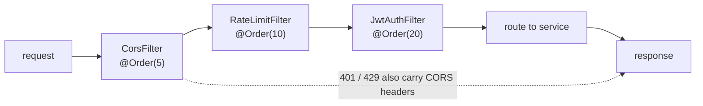

# api-gateway

The single entry point. It routes `/api/v1/**` to the owning service and is the only place that
answers three questions: *who are you*, *may you do this at this rate*, and *is this request even
allowed to reach us*.

| | |
|---|---|
| Port | `8080` |
| Stack | Spring Cloud Gateway **servlet** (`spring-cloud-gateway-server-webmvc` 5.0.4, Cloud 2025.1.4) |
| Store | Redis — rate-limit counters only |
| Own endpoints | `/actuator/health` (public), `/actuator/info` |

The servlet flavour is a deliberate choice, not an accident: it runs on the same Spring MVC stack as
the services, so there is one programming model and no Netty-versus-Tomcat split. The cost is that
Spring Cloud's reactive `RequestRateLimiter` is unavailable — see [rate limiting](#rate-limiting).

---

## Routes

| Path | Service | Upstream |
|---|---|---|
| `/api/v1/auth/**`, `/api/v1/users/**` | user-service | `:8081` |
| `/api/v1/posts/**` | post-service | `:8082` |
| `/api/v1/feed/**` | feed-service | `:8083` |
| `/api/v1/search/**` | search-service | `:8084` |
| `/api/v1/notifications/**` | notification-service | `:8085` |

No path rewriting: services define their own `/api/v1/...` prefixes, so what a client sees is what the
service matches. Every upstream URI is env-overridable (`USER_SERVICE_URI`, …) and defaults to
`127.0.0.1` rather than `localhost`, because on a dual-stack machine `localhost` can resolve to `::1`
and reach an unrelated process holding the same port.

---

## Filter chain



The order is the design, and each step has a reason to be where it is:

- **CORS first (5).** A `401` or `429` is exactly when a browser needs the CORS headers in order to
  read the response. Anything that rejects a request *before* the CORS filter runs produces an error
  the browser reports as a network failure instead.
- **Rate limit before auth (10).** The budget exists to stop *unauthenticated* floods, most obviously
  password guessing on `/auth/login`. Checking it after authentication means verifying tokens an
  attacker has not got yet, plus the crypto.
- **Auth last (20).** Only requests that passed the quota pay for a signature check.

### JwtAuthFilter

1. If `PublicEndpoints.isPublic(method, path)` — allow (`OPTIONS`, `/actuator/health`, register,
   login, refresh).
2. Read `Authorization: Bearer <token>`; missing → `401`.
3. Verify HS256 signature against `jwt.secret`, then `exp`, then `iss == jwt.issuer`, then
   `type == "access"`. Any failure → `401` with a machine-readable `error` field.
4. **Strip any client-supplied `X-User-Id`**, then set it from `sub`.

Step 4 is the one that matters. Services trust `X-User-Id`; the gateway is the only thing allowed to
write it, and a client that sends its own header is ignored rather than obeyed.

Public endpoints live in one explicit class, `PublicEndpoints`, with a comment per entry. An allow-list
scattered across annotations is how "temporarily public" becomes permanent.

### Rate limiting

Fixed window, in Redis:

```java
String key = "ratelimit:" + (auth ? "auth:" : "api:") + clientAddress(request) + ":" + window;
Long count = redisTemplate.opsForValue().increment(key);
if (count == 1) redisTemplate.expire(key, WINDOW);
if (count > limit) { /* 429 + Retry-After */ }
```

| Bucket | Paths | Default | Identity |
|---|---|---|---|
| `auth` | `/api/v1/auth/**` | 20/min | client IP |
| `api` | everything else | 600/min | client IP |

Behaviour worth stating:

- **Fails open.** Redis unavailable → request allowed, warning logged. A limiter that fails closed
  turns a cache outage into "nobody can log in".
- **`429` carries `Retry-After`**, so a well-behaved client waits instead of hammering.
- **Counters are shared across instances**, because they live in Redis: the budget belongs to the
  client, not to whichever gateway answered.

Why hand-rolled instead of an off-the-shelf algorithm: the reactive `RequestRateLimiter` is not
available in the servlet flavour; the MVC flavour's `Bucket4j=` filter ships in the jar but the
library is not on the classpath, and its buckets are in-JVM — so the effective limit multiplies with
the number of instances. Fixed-window Redis counters are distributed by default in about forty lines.
The price is precision; see limits.

### CorsFilter

Exact origins from `CORS_ALLOWED_ORIGINS`, credentials allowed, `OPTIONS` answered immediately. A
wildcard would let any site call the API with a user's token — and browsers refuse wildcard plus
credentials anyway.

---

## Error shape

Every rejection happens before a service is called, so the gateway writes its own body:

```json
{ "timestamp": "2026-11-10T09:14:02Z", "status": 401,
  "error": "invalid_token", "message": "Token expired", "path": "/api/v1/users/…" }
```

`error` is stable and machine-readable (`missing_token`, `invalid_token`, `rate_limited`); `message` is
for humans and may change.

---

## Configuration

| Setting | Env | Default |
|---|---|---|
| `server.port` | — | `8080` |
| `jwt.secret` | `JWT_SECRET` | dev key — must equal user-service's |
| `jwt.issuer` | `JWT_ISSUER` | `user-service` |
| `gateway.rate-limit.enabled` | `RATE_LIMIT_ENABLED` | `true` |
| `gateway.rate-limit.auth-requests-per-minute` | `RATE_LIMIT_AUTH` | `20` |
| `gateway.rate-limit.api-requests-per-minute` | `RATE_LIMIT_API` | `600` |
| `gateway.cors.allowed-origins` | `CORS_ALLOWED_ORIGINS` | four localhost dev origins |
| `spring.data.redis.host` | `REDIS_HOST` | `localhost` |

Under the `prod` profile the same secret guard as user-service refuses to start on the development key.

---

## Known limits

- **A local client can bypass it.** Services bind loopback, so `127.0.0.1:8082` with a forged
  `X-User-Id` still works from the same machine. Loopback is the machine's trust boundary; closing
  this properly needs mTLS or a network policy between services.
- **Fixed windows burst at the boundary**: 20 requests at `:59` and 20 more at `:00` is briefly double
  the intended rate. A sliding window or token bucket smooths it out.
- **Limits are per IP**, so users behind one NAT share a budget — a bigger weakness than the window
  imprecision. Per-user limits need identity, which only exists after authentication.
- **No retries, circuit breaking or upstream timeouts**: a slow service holds the request until the
  client gives up.
- **No tracing and no structured access log**, so correlating a client complaint with a service log
  means matching timestamps by hand.
- **Actuator exposes only `health` and `info`** — no metrics, so there is no request-rate dashboard.
