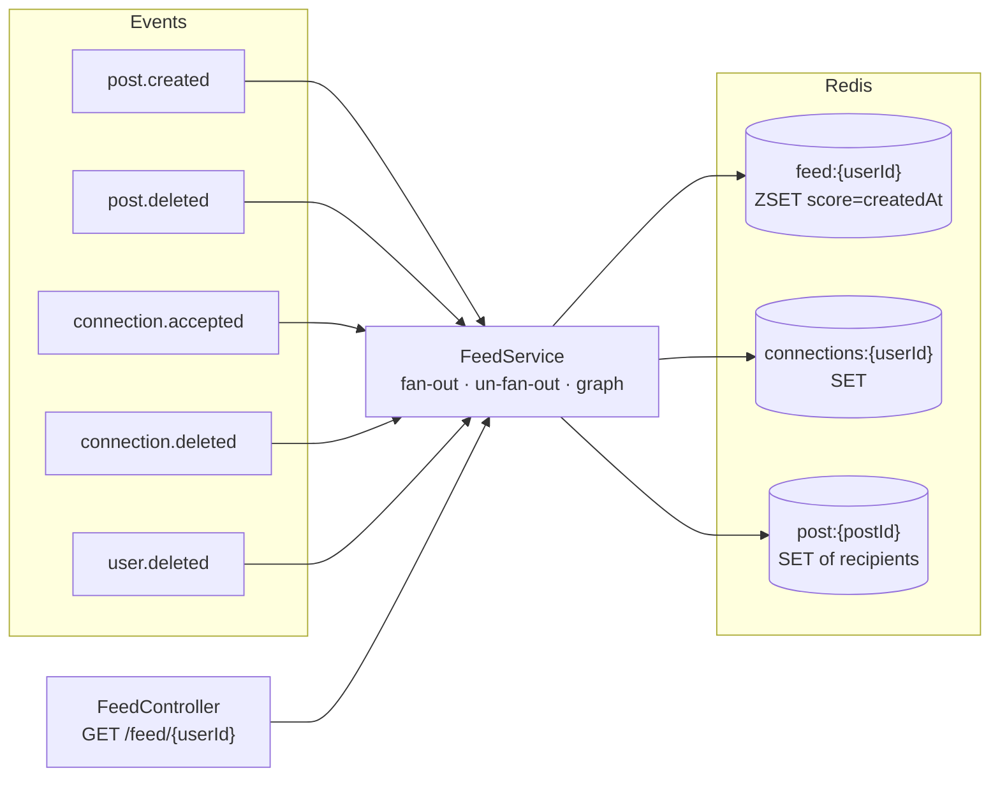
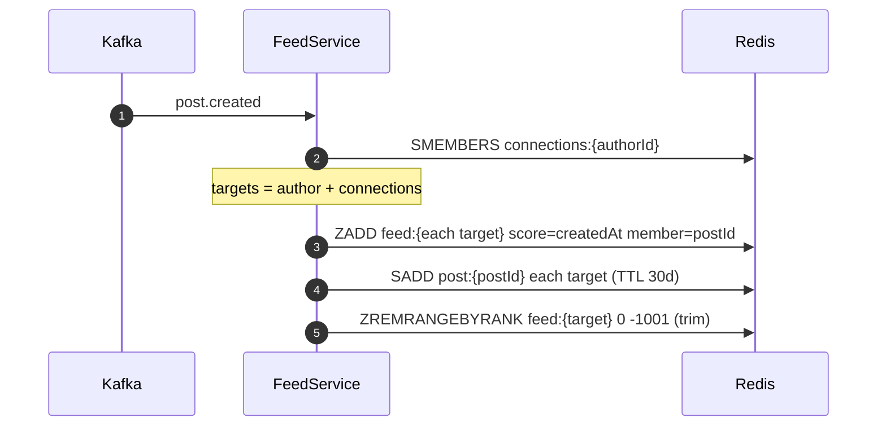

# feed-service

Owns **timelines**: which posts each user should see, in what order. It stores no content — a feed is a
sorted list of post ids, and the client hydrates them from [post-service](../post-service/README.md).

| | |
|---|---|
| Port | `8083` |
| Store | Redis only |
| Publishes | nothing |
| Consumes | `post.created`, `post.deleted`, `connection.accepted`, `connection.deleted`, `user.deleted` |

A pure consumer service: it has no inbound writes except the explicit feed reset, so its state is
entirely derived from events. Delete Redis and every feed rebuilds itself as new posts arrive.

---

## Architecture



### Fan-out on write



Write-time fan-out: one post becomes N writes, and reads become a single `ZREVRANGE`. The author is
included in the target set, so a user sees their own post immediately.

### Why the reverse index exists

Un-fan-out could recompute the audience from the graph — but by then the graph may have changed. The
worst case is account deletion, where `connection.deleted` and `user.deleted` arrive on different
partitions and the graph row is gone *before* the posts are: recomputing yields a smaller set than the
one that actually received the posts, and the posts stay in connection feeds forever.

`post:{postId}` records the recipients at fan-out time, so removal does not depend on the graph, on
event order, or on the author still existing. It is written with a 30-day TTL — long enough to cover
any realistic delete, short enough not to accumulate.

---

## Data

| Key | Type | Contents | TTL |
|---|---|---|---|
| `feed:{userId}` | ZSET | member `postId`, score = `createdAt` epoch millis | trimmed to 1000 entries |
| `connections:{userId}` | SET | ids of mutual connections | none |
| `post:{postId}` | SET | ids of the feeds this post was written to | 30 days |

`max-feed-size: 1000` bounds memory per user: the oldest entries fall off the end, which is also a
reasonable product decision — nobody scrolls past a thousand posts.

---

## Endpoints

| Method | Path | Query | Success | Errors |
|---|---|---|---|---|
| `GET` | `/api/v1/feed/{userId}` | `page` (0-based, default `0`), `size` (default `20`, max `100`) | `200` `FeedResponse` | `403` not your feed, `400` bad paging |
| `DELETE` | `/api/v1/feed/{userId}` | — | `204` | `403` not your feed |

`FeedResponse`:

```json
{
  "userId": "…",
  "postIds": ["…", "…"],
  "page": 0,
  "size": 20,
  "totalElements": 137,
  "totalPages": 7,
  "hasNext": true
}
```

Both endpoints call `requireSelf` — a feed is private even though post ids are not.

`DELETE` is a testing convenience with a real use: reset a feed between script runs without shell
access to Redis. It is idempotent; clearing an empty feed is still `204`.

---

## Events consumed

| Topic | Handler | Effect |
|---|---|---|
| `post.created` | `fanOutPost` | `ZADD` into the author's and every connection's feed, record reverse index, trim |
| `post.deleted` | `removePostFromFeeds` | `ZREM` from the recorded recipients (or the graph, for posts predating the index), delete the index key |
| `connection.accepted` | `addConnection` | two `SADD`s: `A → B` and `B → A` |
| `connection.deleted` | `removeConnection` | two `SREM`s, so future posts stop fanning out |
| `user.deleted` | `removeUser` | `DEL` the feed and graph, then `SCAN` all `connections:*` and `SREM` the id |

Two `SADD`s instead of an atomic multi-key write is deliberate: `SADD`/`SREM` are idempotent, so a
crash between them is healed by Kafka's redelivery rather than leaving a half-connected graph.

Reconnection needs no special case — the sets hold no memory of the removal.

---

## Running

```bash
docker compose up -d redis kafka
./mvnw spring-boot:run          # :8083
```

| Setting | Env | Default |
|---|---|---|
| `spring.data.redis.host` | `REDIS_HOST` | `localhost` |
| `feed.max-feed-size` | — (hardcoded) | `1000` |
| `server.address` | `SERVER_ADDRESS` | `127.0.0.1` |

---

## Known limits

- **No backfill.** A user who connects today does not see yesterday's posts from their new
  connection; the feed starts from the next `post.created`.
- **Fan-out is O(connections) per post** and unbounded. A user with 50,000 connections produces 50,000
  `ZADD`s in one handler — the classic celebrity problem. The usual fix is hybrid fan-out: write to
  the author's own feed only, and merge pull-side at read time for high-degree users.
- **Ids can dangle.** Nothing revalidates a feed entry against `post-service`; correctness depends on
  `post.deleted` always arriving. An event lost in the publish window leaves a broken card.
- **No unread or ranking logic** — the score is `createdAt`, so the timeline is strictly
  reverse-chronological.
- **`user.deleted` does a `SCAN` over all `connections:*`**, which is fine at thousands of keys and
  hostile at millions. A per-user "who connected to me" set would make it O(1).