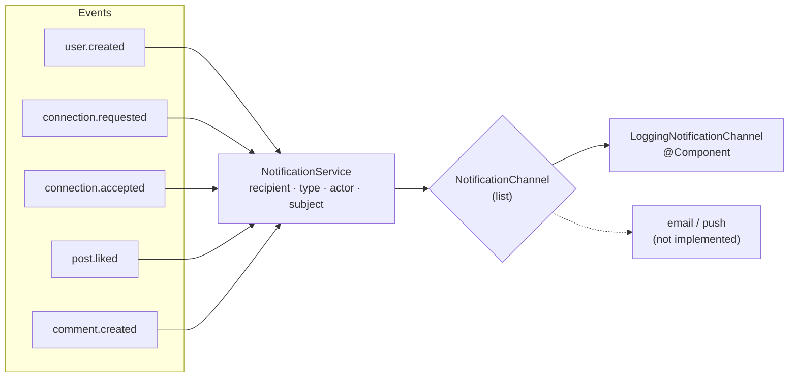

# notification-service

Owns **activity delivery**: deciding who should be told that something happened, and sending it
through a channel.

| | |
|---|---|
| Port | `8085` |
| Store | none — stateless |
| Publishes | nothing |
| Consumes | `user.created`, `connection.requested`, `connection.accepted`, `post.liked`, `comment.created` |
| Endpoints | **none** |

It is the smallest service and the only one without an HTTP API: it exists to be called by Kafka. A
request to `/api/v1/notifications` through the gateway returns `404`, because there is nothing to
serve — notifications are delivered at the moment they happen, not stored and read later.

That is the honest shape of the service rather than an oversight. Persisting them is the obvious next
step (see limits).

---

## Architecture



The channel is an interface with one method:

```java
public interface NotificationChannel {
    void deliver(Notification notification);
}
```

`NotificationService` holds `List<NotificationChannel>` and calls every one. Adding email or push means
adding a `@Component` and nothing else — no switch statement, no service edit. Today there is exactly
one implementation, and it writes a log line.

### Two rules, in one place

```java
if (recipientId == null || recipientId.isBlank()) return;   // unsendable event
if (recipientId.equals(actorId)) return;                    // acting on your own content
```

Both are deliberate silences. Liking your own post is legal; being notified about it is noise. And an
event whose recipient cannot be determined is dropped rather than sent to a placeholder.

---

## Data

`Notification` — an immutable record, never persisted:

| Field | Meaning |
|---|---|
| `recipientId` | who is told |
| `type` | `CONNECTION_REQUEST`, `CONNECTION_ACCEPTED`, `POST_LIKED`, `POST_COMMENTED`, `WELCOME` |
| `actorId` | who did it (`null` for `WELCOME`) |
| `subjectId` | the thing it happened to: connection id, post id, or the user's own id |
| `createdAt` | when the service decided to send |

Delivered output looks like:

```
NOTIFY [POST_LIKED] to=68a1… actor=68b2… subject=post-42 at=2026-11-10T09:14:02.113
```

---

## Events consumed

| Topic | Type | Recipient | Actor | Subject |
|---|---|---|---|---|
| `user.created` | `WELCOME` | the new user | — | the new user |
| `connection.requested` | `CONNECTION_REQUEST` | **receiver** | requester | connection id |
| `connection.accepted` | `CONNECTION_ACCEPTED` | **requester** | receiver | connection id |
| `post.liked` | `POST_LIKED` | post author | the liker | post id |
| `comment.created` | `POST_COMMENTED` | post author | commenter | post id |

The recipient choice is the whole job: for a *request*, the person who needs to act is the receiver;
for an *acceptance*, it is the requester who is waiting. Getting that backwards produces a service
that notifies people about their own actions.

---

## Running

```bash
docker compose up -d kafka
./mvnw spring-boot:run          # :8085
```

| Setting | Env | Default |
|---|---|---|
| `spring.kafka.bootstrap-servers` | `KAFKA_BOOTSTRAP_SERVERS` | `localhost:9092` |
| `spring.kafka.consumer.group-id` | — | `notification-service` |
| `server.address` | `SERVER_ADDRESS` | `127.0.0.1` |

Verify it is alive by watching the log while using the API elsewhere:

```bash
./mvnw spring-boot:run | grep NOTIFY
```

`KafkaErrorConfig` gives every consumer the same failure policy as the rest of the system: two retries,
then the record goes to `<topic>-dlt` instead of blocking the partition.

---

## Known limits

- **No persistence.** A notification exists for as long as it takes to log it. Nothing survives a
  restart, and a client cannot fetch history.
- **No user preferences.** Everyone is notified about everything; there is no mute, digest, or
  per-type opt-out.
- **One channel, and it is a log line.** Real delivery needs email/push credentials, retries against
  the provider, and bounce handling — none of which are here.
- **At-least-once means occasional duplicates**, and with no stored notification there is no id to
  deduplicate on.
- **Fan-out is per event, one recipient.** Batched digests ("3 people liked your post") would need
  aggregation, which needs state.
- **`post.unliked` and `comment.deleted` are not consumed**, so a notification cannot be retracted
  when the action is undone.