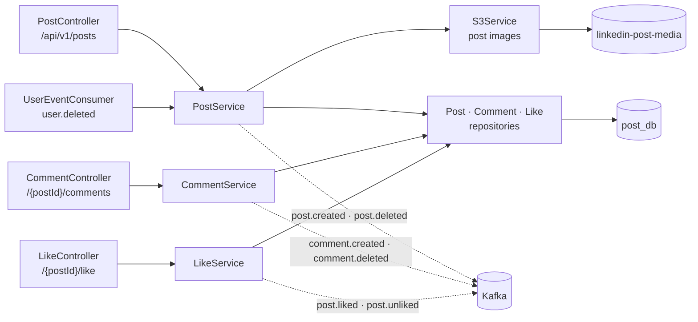

# post-service

Owns **content**: posts, their media, comments, and likes. It is the write side of everything that
appears in a feed or a search result; `feed-service` and `search-service` only keep projections of
what happens here.

| | |
|---|---|
| Port | `8082` |
| Store | MySQL `post_db`, S3 `linkedin-post-media` |
| Publishes | `post.created`, `post.deleted`, `post.liked`, `post.unliked`, `comment.created`, `comment.deleted` |
| Consumes | `user.deleted` |

---

## Architecture



Two details decide most of the behaviour here:

**Counters are denormalised and incremented in SQL.** `likeCount` and `commentCount` live on the post
row and are updated with `UPDATE ... SET like_count = like_count + 1`, not read-modify-write in Java.
Two people liking the same post at the same instant cannot lose one of the increments.

**Likes are idempotent by construction.** A unique constraint on `(post_id, author_id)` plus an
existence check means `PUT /like` twice is a no-op that returns the current state rather than an
error. When two identical requests do race past the check, the second insert violates the constraint
and the global handler turns that into `409` instead of `500` — the correct answer for "this already
exists".

---

## Data

`posts`

| Column | Notes |
|---|---|
| `id` | PK, UUID (`GenerationType.UUID`) |
| `author_id` | user id — **no foreign key**, that user lives in another service |
| `content` | `TEXT`, trimmed, must be non-empty |
| `image_url` | what clients render |
| `image_key` | the object key, so deletion does not have to parse the URL |
| `like_count`, `comment_count` | denormalised counters, updated atomically |
| `created_at`, `updated_at` | |

`comments` — `id`, `post_id`, `author_id`, `content`, `created_at`.

`likes` — `id`, `post_id`, `author_id`, `created_at`; unique `(post_id, author_id)`.

**S3** — `posts/{authorId}/image-{uuid}.{ext}` in `linkedin-post-media`.

---

## Endpoints

### Posts

| Method | Path | Body | Success | Errors |
|---|---|---|---|---|
| `POST` | `/api/v1/posts` | multipart: `content`, optional `image` | `201` `PostResponse` | `400` empty content, `401` |
| `GET` | `/api/v1/posts/{postId}` | — | `200` `PostResponse` | `404` |
| `GET` | `/api/v1/posts/user/{authorId}` | — | `200` list | — |
| `DELETE` | `/api/v1/posts/{postId}` | — | `204` | `403` not the author, `404` |

`POST /posts` is `multipart/form-data` because a post may carry an image. Content is mandatory; the
image is not.

### Comments

| Method | Path | Body | Success | Errors |
|---|---|---|---|---|
| `POST` | `/api/v1/posts/{postId}/comments` | `CreateCommentRequest` | `201` `CommentResponse` | `400`, `404` post |
| `GET` | `/api/v1/posts/{postId}/comments` | — | `200` list | `404` post |
| `DELETE` | `/api/v1/posts/{postId}/comments/{commentId}` | — | `204` | `403` not the comment author, `404` |

### Likes

| Method | Path | Success | Errors |
|---|---|---|---|
| `PUT` | `/api/v1/posts/{postId}/like` | `200` `PostLikeResponse` | `404` post |
| `DELETE` | `/api/v1/posts/{postId}/like` | `200` `PostLikeResponse` | `404` post |

Both return `{postId, liked, likeCount}`, so a client never has to guess the state after the call.

---

## Events

Published:

| Topic | Key | When | Payload |
|---|---|---|---|
| `post.created` | postId | post created | `postId`, `authorId`, `content`, `createdAt` |
| `post.deleted` | postId | post or account deleted | `postId`, `authorId` |
| `post.liked` | postId | first like only | `postId`, `postAuthorId`, `likedBy` |
| `post.unliked` | postId | unlike | `postId`, `postAuthorId`, `unlikedBy` |
| `comment.created` | commentId | comment created | `commentId`, `postId`, `postAuthorId`, `commenterId`, `createdAt` |
| `comment.deleted` | postId | comment removed | `commentId`, `postId`, `authorId` |

Consumed:

| Topic | Handler | What it does |
|---|---|---|
| `user.deleted` | `UserEventConsumer` → `deletePostsByAuthor` | deletes the author's posts, comments and likes, removes media, emits one `post.deleted` per post |

Account deletion is the only inbound path: this service never asks `user-service` anything, it waits
to be told.

---

## Running

```bash
docker compose up -d mysql kafka s3mock
./mvnw spring-boot:run          # :8082
```

| Setting | Env | Default |
|---|---|---|
| `spring.datasource.url` | `DB_HOST`, `DB_PORT`, `DB_NAME` | `post_db` on `localhost:3306` |
| `aws.endpoint` | `AWS_ENDPOINT` | *empty* — real AWS. Set `http://localhost:9090` for s3mock |
| `aws.bucket-name` | `AWS_S3_BUCKET` | `linkedin-post-media` |
| `server.address` | `SERVER_ADDRESS` | `127.0.0.1` |

---

## Known limits

- **No pagination** on `/posts/user/{authorId}` or the comments list: both return every row.
- **Media is deleted after the row, best-effort.** If S3 fails the image is orphaned and only a log
  line records it — the post the author asked to remove is still gone, which is the priority.
- **`deletePostsByAuthor` is a loop**, not a batch: N posts mean N deletes, N S3 calls and N events.
  Fine for tens of posts, laborious for thousands.
- **Content has no length ceiling** beyond `TEXT`, and no moderation hook.
- **Counters are maintained by hand**; a post deleted while a like is in flight takes its counter
  with it, which is correct here but would not be if counters were stored elsewhere.
- **`imageUrl` points at whatever S3 endpoint was configured when it was written.** Moving to a CDN
  leaves old rows pointing at the old host — `image_key` is what makes a backfill possible.
