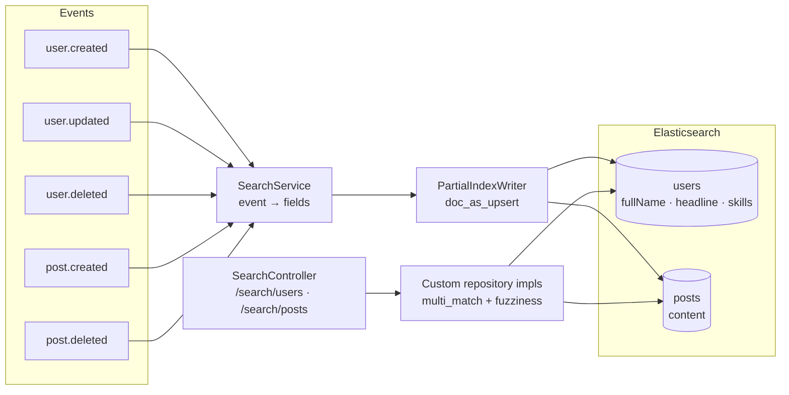
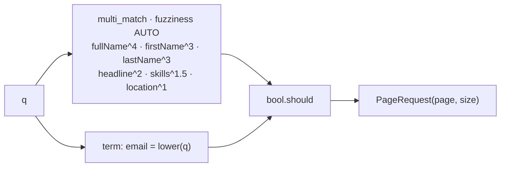

# search-service

Owns **discovery**: turning the write-side events of other services into searchable projections of
people and posts.

| | |
|---|---|
| Port | `8084` |
| Store | Elasticsearch: indexes `users`, `posts` |
| Publishes | nothing |
| Consumes | `user.created`, `user.updated`, `user.deleted`, `post.created`, `post.deleted` |

This service never owns a fact — it owns a *copy* of facts owned elsewhere, shaped for querying. That
makes it the one place where eventual consistency is visible to users: a new post is searchable a
moment after it is created, not in the same request.

---

## Architecture



### One writer, partial updates

Every consumer ultimately calls the same thing:

```java
UpdateQuery.builder(id).withDocument(Document.from(fields)).withDocAsUpsert(true)
```

`doc_as_upsert` matters. `user.created` only knows name and email; `user.updated` knows headline,
location and skills. If each event replaced the whole document, whichever arrived last would erase
the other's fields — and `user.created` can arrive *after* `user.updated` if both are redelivered.
Updating rather than overwriting means each event contributes its own fields and nothing is lost.

The same call is the creation path, so an out-of-order `user.updated` before `user.created` still
produces a usable document.

---

## Data

`users` — `userId` (keyword, `@Id`), `firstName`/`lastName` (text, `copyTo: fullName`), `fullName`
(text), `headline`, `location`, `skills`, `email` (keyword, lower-cased on write).

`posts` — `postId` (keyword, `@Id`), `authorId` (keyword), `content` (text).

Mappings are created by Spring Data on first write (`createIndex = true`) and **never migrated** — a
changed `@Field` needs the index dropped and rebuilt.

---

## Query strategy



The boosts encode a product opinion about relevance: a name match beats a headline match, and a
headline beats a skill. `fuzziness: AUTO` absorbs typos of one or two characters at query time
instead of needing an edge-ngram field.

Email is not analysed text — it is a `keyword` compared with an exact, lower-cased `term`. Fuzzy
matching an email address would match every similar-looking person's address.

---

## Endpoints

| Method | Path | Query | Success | Errors |
|---|---|---|---|---|
| `GET` | `/api/v1/search/users` | `q` (required, ≤ 100 chars), `page` (≥ 0), `size` (1–50, default 20) | `200` `SearchResponse<SearchUserResponse>` | `400` blank/too long `q`, `400` bad paging |
| `GET` | `/api/v1/search/posts` | same | `200` `SearchResponse<SearchPostResponse>` | same |

```json
{
  "query": "ada",
  "results": [{ "userId": "…", "firstName": "Ada", "lastName": "Lovelace", "headline": "…" }],
  "page": 0, "size": 20, "totalElements": 1, "totalPages": 1, "hasNext": false
}
```

Both require an `X-User-Id` header: anyone authenticated may search for anyone, but search is not
public, because it exposes the whole user directory. `size` is capped at 50 so one query cannot pull
the index.

---

## Events consumed

| Topic | Fields written | Effect |
|---|---|---|
| `user.created` | `userId`, `firstName`, `lastName`, `email` | upsert, or create the document |
| `user.updated` | `userId`, `firstName`, `lastName`, `headline`, `location`, `skills` | update those fields only |
| `user.deleted` | — | delete from `users` **and** from `posts` (the author's posts are gone too) |
| `post.created` | `postId`, `authorId`, `content` | upsert into `posts` |
| `post.deleted` | — | delete from `posts` |

`user.deleted` removing posts is a deliberate over-reach: `post.deleted` follows for each of the
author's posts, but if one of those events is lost the index would keep returning content belonging to
a deleted account. Deleting on the way out is cheaper than trusting every follow-up event.

---

## Running

```bash
docker compose up -d elasticsearch kafka
./mvnw spring-boot:run          # :8084
```

| Setting | Env | Default |
|---|---|---|
| `spring.elasticsearch.uris` | `ES_URIS` | `http://localhost:9200` |
| `server.address` | `SERVER_ADDRESS` | `127.0.0.1` |

The index is empty until events arrive. Seeding it from an existing database means republishing
`user.created`/`post.created` — there is no backfill job (see limits).

---

## Known limits

- **No backfill or reindex.** Drop the index and data returns only as new events arrive. A
  `POST /search/reindex` that pages through the owning services is the obvious next step.
- **No analyser tuning.** The default standard analyser stems nothing and knows no synonyms, so
  "engineer" does not match "engineering".
- **Mappings cannot evolve.** A new `@Field` needs the index deleted and rebuilt; there is no alias
  indirection to allow a zero-downtime reindex.
- **Eventual consistency is visible**: a post created and searched within the same second may not
  appear yet.
- **Partial documents are possible** if `user.updated` is the only event a document ever receives —
  searchable, but with no email.
- **No permission filtering.** Every user and post is searchable regardless of connection status:
  right for a directory, wrong if content ever becomes connection-only.
