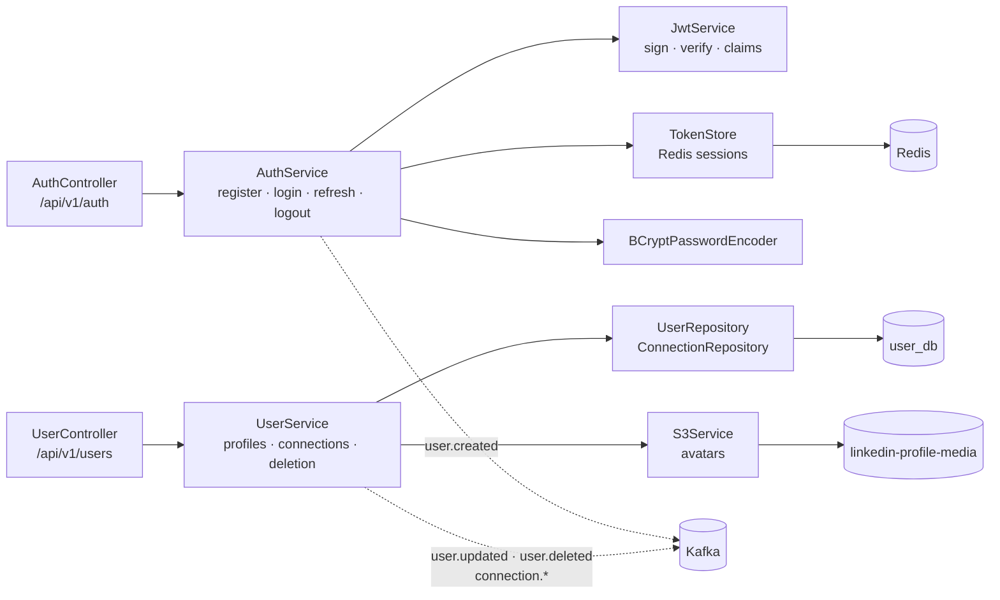
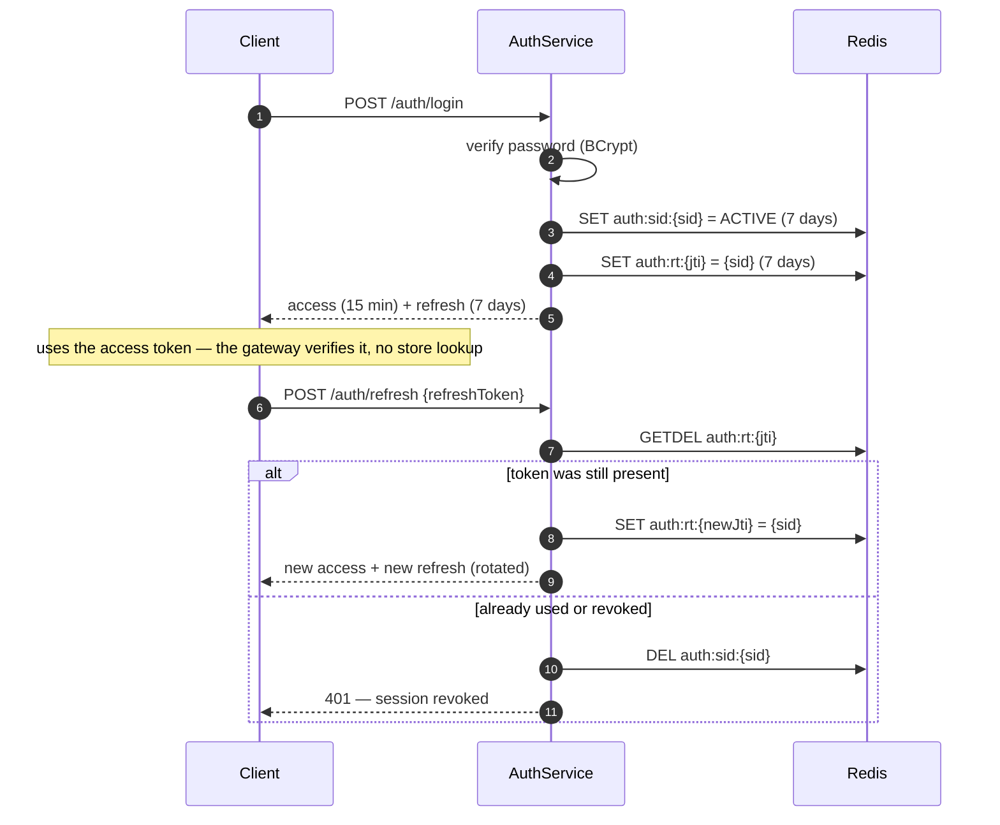

# user-service

Owns **identity**: accounts, password authentication, the token pair and its rotation, profiles, and
the connection graph.

It is the only service that mints tokens. No service validates them — the
[api-gateway](../api-gateway/README.md) does that once, at the edge, and forwards the caller's id in
`X-User-Id`. That single split is why this service can be restarted without logging everyone out
(access tokens are stateless) while still supporting real logout (refresh tokens are not).

| | |
|---|---|
| Port | `8081` |
| Store | MySQL `user_db`, Redis, S3 `linkedin-profile-media` |
| Publishes | `user.created`, `user.updated`, `user.deleted`, `connection.requested`, `connection.accepted`, `connection.deleted` |
| Consumes | nothing |

---

## Architecture



| Package | Responsibility |
|---|---|
| `controller` | HTTP shape, `requireSelf(...)` on every mutating profile call |
| `service` | business rules: `AuthService` (tokens), `UserService` (profiles, graph), `S3Service` (media) |
| `security` | `JwtService` signs and verifies; `TokenStore` owns session state in Redis |
| `repository` | Spring Data JPA; the only code that touches SQL |
| `entity` | `User`, `Connection`, `ConnectionStatus`, `UserRole` |
| `event` | one immutable record per published topic |
| `config` | `JwtProperties`, `AwsProperties`, `BCryptConfig`, `SecretGuard` |
| `exception` | `ApiException` + `GlobalExceptionHandler` → the shared error body |

---

## The token model



`GETDEL` is what makes rotation a real one-time exchange instead of a check-then-act race: two
refreshes with the same token cannot both succeed. The second is treated as replay, and since we
cannot tell a stolen token from a duplicate tab, the whole session dies.

| Claim | In access | In refresh | Purpose |
|---|---|---|---|
| `sub` | ✓ | ✓ | user id — becomes `X-User-Id` |
| `iss` | ✓ | ✓ | `user-service`; the gateway rejects anything else |
| `sid` | ✓ | ✓ | session id, so logout can revoke a whole family |
| `jti` | ✓ | ✓ | one token instance; the refresh lookup key |
| `type` | ✓ | ✓ | `access` / `refresh`, so one cannot be used as the other |
| `email` | ✓ | — | convenience for clients |

---

## Data

**MySQL `user_db`** — schema created by JPA on start (`createDatabaseIfNotExist=true` in the JDBC URL).

`users`

| Column | Type | Notes |
|---|---|---|
| `id` | `varchar` PK | UUID (`GenerationType.UUID`), generated by JPA |
| `email` | `varchar` unique | the login identifier |
| `password` | `varchar` | BCrypt hash, never leaves the service |
| `first_name`, `last_name` | `varchar` not null | |
| `headline`, `about`, `location` | `varchar` | all nullable, all searchable |
| `profile_photo_url` / `profile_photo_key` | `varchar` | URL for clients, **key** so the object can be deleted |
| `cover_photo_url` | `varchar` | |
| `role` | `varchar(20)` | `UserRole` enum |
| `skill` | list | `List<String>` via a converter |
| `created_at`, `updated_at` | `timestamp` | |

`connections`

| Column | Notes |
|---|---|
| `id` | PK |
| `requester_id`, `receiver_id` | user ids; direction matters for who may accept |
| `status` | `PENDING` → `CONNECTED`, or `REJECTED`, or `REMOVED` |
| `connected_at` | set when accepted |
| `created_at`, `updated_at` | |

A removed connection is kept as `REMOVED`, not deleted — the pair can reconnect, and a previous
relationship is not erased by unfollowing someone.

**Redis**

| Key | Value | TTL |
|---|---|---|
| `auth:sid:{sid}` | `ACTIVE` | 7 days (refresh lifetime) |
| `auth:rt:{jti}` | `{sid}` | 7 days |

**S3** — `profiles/{userId}/avatar-{uuid}.{ext}` in `linkedin-profile-media`.

---

## Endpoints

All paths are as the gateway exposes them; the service itself listens on `:8081`.

### Authentication — public

| Method | Path | Body | Success | Errors |
|---|---|---|---|---|
| `POST` | `/api/v1/auth/register` | `RegisterRequest` | `201` + `AuthResponse` | `400` validation, `409` email taken |
| `POST` | `/api/v1/auth/login` | `LoginRequest` | `200` + `AuthResponse` | `401` bad credentials, `429` rate limited |
| `POST` | `/api/v1/auth/refresh` | `RefreshRequest` | `200` + `AuthResponse` (rotated) | `401` expired / replayed |
| `POST` | `/api/v1/auth/logout` | `LogoutRequest` (optional) | `204` | — |

Register returns tokens: a client that just signed up should not have to log in again.

### Profiles — authenticated

| Method | Path | Body | Success | Errors |
|---|---|---|---|---|
| `GET` | `/api/v1/users/{userId}` | — | `200` `UserResponse` | `404` |
| `PUT` | `/api/v1/users/{userId}/profile` | `UpdateProfileRequest` | `200` `UserResponse` | `403` not you, `404` |
| `POST` | `/api/v1/users/{userId}/upload/profile-photo` | multipart `file` | `200` `UserResponse` | `400` empty/not an image, `403` |
| `DELETE` | `/api/v1/users/{userId}` | — | `204` | `403` not you, `404` |

`PUT /profile` is a partial update: only non-null fields are applied, so a client can send a single
field without clobbering the rest.

### Connections — authenticated

| Method | Path | Success | Errors |
|---|---|---|---|
| `POST` | `/api/v1/users/{targetUserId}/connect` | `201` `ConnectionResponse` | `400` self-connect, `404` no such user, `409` already pending/connected |
| `POST` | `/api/v1/users/connections/{connectionId}/accept` | `200` | `403` not the receiver, `409` not pending |
| `POST` | `/api/v1/users/connections/{connectionId}/reject` | `200` | `403`, `409` |
| `DELETE` | `/api/v1/users/connections/{connectionId}` | `200` | `403` not a participant, `409` not connected |
| `GET` | `/api/v1/users/{userId}/connections` | `200` list of `UserResponse` | — |
| `GET` | `/api/v1/users/{userId}/connections/pending` | `200` list | — |

Errors use the shared body: `{"timestamp", "status", "error", "message", "path"}`.

---

## Events published

| Topic | Key | When | Payload |
|---|---|---|---|
| `user.created` | userId | registration succeeded | `userId`, `firstName`, `lastName`, `email` |
| `user.updated` | userId | profile changed or photo replaced | `userId`, `firstName`, `lastName`, `headline`, `location`, `skills` |
| `user.deleted` | userId | account deletion | `userId` |
| `connection.requested` | connectionId | request sent | `connectionId`, `requesterId`, `receiverId` |
| `connection.accepted` | connectionId | request accepted | `connectionId`, `requesterId`, `receiverId` |
| `connection.deleted` | connectionId | disconnect | `connectionId`, `requesterId`, `receiverId` |

Events are sent after the database write commits and are not transactional with it. A crash in that
window loses the event; the alternative (dual write inside a transaction) needs an outbox table,
which this system does not have.

---

## Running

```bash
docker compose up -d mysql redis kafka s3mock
export AWS_ENDPOINT=http://localhost:9090      # without it, uploads go to real AWS and fail
SPRING_PROFILES_ACTIVE=dev ./mvnw spring-boot:run          # :8081
```

The `dev` profile is required, not cosmetic: with the committed signing key and no profile, this
service refuses to start.

| Setting | Env | Default |
|---|---|---|
| `jwt.secret` | `JWT_SECRET` | dev key — **must match the gateway**, and only accepted under `dev` |
| `jwt.expiration` | `JWT_EXPIRATION` | `900000` ms |
| `jwt.refresh-expiration` | `JWT_REFRESH_EXPIRATION` | `604800000` ms |
| `jwt.issuer` | `JWT_ISSUER` | `user-service` |
| `aws.endpoint` | `AWS_ENDPOINT` | *empty* — real AWS. Set `http://localhost:9090` for s3mock |
| `aws.bucket-name` | `AWS_S3_BUCKET` | `linkedin-profile-media` |
| `server.address` | `SERVER_ADDRESS` | `127.0.0.1` |

---

## Known limits

- **Access tokens outlive logout** (up to 15 minutes). Revoking them immediately would mean the
  gateway checking Redis on every request.
- **No refresh grace window.** Two clients refreshing simultaneously: the loser looks like a thief,
  and the session is revoked. A 30-second reuse window per `jti` would fix it.
- **Logout without a body** ends only what the request can identify; the access token in hand stays
  valid regardless.
- **Password rules are enforced at the DTO**, not by policy history — no "reused password" check,
  no breach-list lookup.
- **No email verification**, so `user.created` means "someone typed this address".
- **`skills` is a single `varchar` column** with a converter; fine for reads, unsuitable for
  querying by skill.
